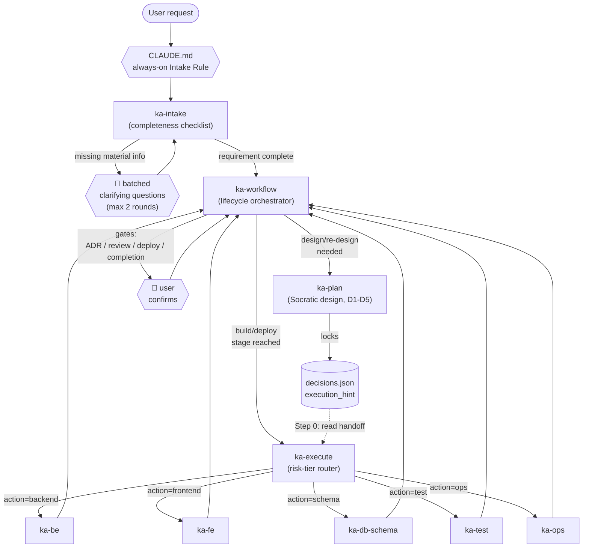

# Ka Skills — `ka-intake` + `ka-plan` + `ka-execute` + `ka-workflow`

An agentskills.io-spec-compliant skill set for AI-agent-driven development, covering the full lifecycle: requirement intake → design → execution → orchestration.

| Skill | Role | Invocation |
|---|---|---|
| `ka-intake` | Requirement completeness checker — asks before the AI assumes | Auto, via the always-on rule in `CLAUDE.md` (`user-invocable: false`) |
| `ka-plan` | Socratic design/architecture facilitator | Auto on ambiguous design questions, or `/ka-plan` |
| `ka-execute` | Risk-tiered execution router to worker skills | Auto after `ka-plan` locks a decision, or `/ka-execute` |
| `ka-workflow` | Full lifecycle orchestrator (design → build → review → deploy → archive) | `/ka-workflow`, or auto when tracking an in-progress feature |
| `ka-be` | Backend implementation developer (Clean Architecture & DDD) | Called by `ka-execute` (`user-invocable: false`) |
| `ka-fe` | Frontend UI implementation developer (React/TanStack) | Called by `ka-execute` (`user-invocable: false`) |
| `ka-db-schema` | Database schema designer (Drizzle ORM) | Called by `ka-execute` (`user-invocable: false`) |
| `ka-test` | QA & Test Suite Architect (PGLite integration tests) | Called by developers / execution (`user-invocable: false`) |
| `ka-ops` | DevOps & Site Reliability Engineer (Docker/K8s/CI/CD) | Called by `ka-execute` (`user-invocable: false`) |
| `ka-contract` | API Contract Designer (OpenAPI / Zod / Orval) | Explicit `/ka-contract` or called during pipeline |
| `ka-review` | Code & Architecture compliance auditor | Explicit `/ka-review` or called during review stage |
| `git-guardian` | Git Safety Layer (10 Mandatory Rules) | Called during git commands (`user-invocable: false`) |

---

## 🌟 Key Upgrades & Core Capabilities (Universal Engineering)

1. **Polyglot Clean Architecture (TS, Go, Python)**:
   - Unified 4-tier Clean Architecture mapping across TypeScript (NestJS, React, Tauri), Golang (CQRS, Worker Pools), and Python (FastAPI, Hexagonal, SQLite WAL Outbox).
   - Core standards maintained in `standards/UNIVERSAL_CLEAN_STANDARD.md`.

2. **One-Way Dependency & Registry Pattern (ADR-011)**:
   - Strict DAG module boundaries: Tier 1 (Foundation) ➔ Tier 2 (Domain Core) ➔ Tier 3 (Process Flow).
   - Zero circular dependencies: total ban on `forwardRef()`. Cross-module decoupled via **Registry Pattern** and **Domain Events with Self-Contained Payloads** (`standards/ONE_WAY_REGISTRY_STANDARD.md`).

3. **Fast-Track Autonomous Execution (No Conversational Loops)**:
   - When speed is critical, bypass iterative questioning using pre-packaged spec templates in `skills/ka-intake/templates/`:
     - `fast-track-feature.md`: New features with domain invariants & FSM.
     - `fast-track-hotfix.md`: Root-Cause-First 5-step emergency fixes.
     - `fast-track-worker.md`: Resilient async queues, circuit breakers, offline buffers.
     - `fast-track-refactor.md`: Clean architecture restructuring & cycle breaking.

4. **Interactive E2E Visual Screenshot Testing**:
   - Automated 4-stage visual verification (`artifacts/screenshots/`):
     - `Stage 1`: Initial / Empty State.
     - `Stage 2`: In-flight / Loading & Disabled Button State.
     - `Stage 3`: Success State & Toast notifications.
     - `Stage 4`: Error Banner & Recovery State.
   - Generates visual Markdown reports with embedded screenshot paths (`skills/ka-test/references/visual-screenshot-testing.md`).

5. **Smart Deployment & Anti-Bottleneck Node Architecture**:
   - Node separation (API BFF vs Async Worker Nodes).
   - DB Connection Pool formula: $Pool \le (MaxConn \times 0.8) / Instances$ + PgBouncer.
   - Worker concurrency formulas for CPU-bound vs I/O-bound jobs.
   - Zero-Downtime rolling updates with Readiness/Liveness Probes and Graceful Shutdown drains (`skills/ka-ops/references/anti-bottleneck-deployment.md`).

6. **Anti-AI Garbage & Ghost Code Gatekeeper**:
   - Enforces active call-graph reference checks (knip/ts-prune/vulture): bans code with 0 runtime callers.
   - Single Screen Viewport Rule: $\le 40-50$ lines/function, $\le 2$ levels of nesting.
   - Anti-Fraud: Zero hardcoded reconciliation (`if id == ...`), algebraic formulas only (`standards/ANTI_AI_GARBAGE_CODE.md`).

---

## Why `ka-intake` isn't "just another skill"

Skills only load when their `description` matches the request — there is no frontmatter field that makes a skill unconditionally active. The one thing that *is* unconditional is `CLAUDE.md`. So the "always ask before assuming" behavior is split across two layers:

- **`CLAUDE.md`** (see `CLAUDE.md.snippet` — append this to your project's real `CLAUDE.md`) — the hard, always-loaded rule.
- **`ka-intake`** — the detailed checklist and question logic that rule points to.

Without both pieces, "always active" doesn't actually hold.

---

## How they connect

```
User request
     │
     ▼
CLAUDE.md always-on Intake Rule
     │
     ▼
ka-intake — completeness checklist
     │  missing + material? → 🛑 batched questions (max 2 rounds)
     │  complete? ────────────────────────────────┐
     ▼                                             │
ka-workflow (lifecycle orchestrator) ◄─────────────┘
     │
     ├─ design stage ──► ka-plan (D1 → D5) ──locks──► decisions.json (execution_hint)
     │
     └─ build/deploy stage ──► ka-execute
                                   │  Step 0: reads decisions.json if present
                                   │  Step 4b: validates options against schema
                                   │  Step 5: risk-tiered confirmation (1-4)
                                   ▼
                         ka-be / ka-fe / ka-db-schema / ka-test / ka-ops
                                   │
                                   ▼
                         decisions.json updated with consumed_at
```

See `skills/ka-workflow/assets/architecture-overview.mermaid` for the rendered diagram, and `skills/ka-workflow/assets/lifecycle-state-machine.mermaid` for the full state/gate machine.



---

## Usage examples

### 1. Vague request → intake asks first

```
User: hủy đơn hàng #1234
```
→ `ka-intake` checks the checklist, finds "edge_cases" material and missing (đơn đã giao chưa?) → asks in one batched message → user answers → `ka-workflow` proceeds with the complete requirement.

### 2. Full flow: intake clean → design → execute

```
User: nên xử lý auth kiểu gì cho chuẩn, hiện tại đang session-based
```
→ `ka-intake` finds nothing material missing (question is already fully self-contained as a design comparison) → `ka-plan` runs D1–D5 → locks `decisions.json` with `execution_hint` → `ka-execute` Step 0 finds it, confirms, routes to `ka-be`.

### 3. High-risk ops action

```
User: /ka-execute ops '{"env":"production","action":"deploy"}'
```
→ Step 4b rejects: missing `rollback_plan`, required when `env == "production"`. Resubmit → tier-4 confirmation (type "ops" + explicit rollback acknowledgement).

---

## Risk-tier table (`ka-execute` Step 5)

| Tier | Actions | Confirmation |
|---|---|---|
| 1 (low) | `frontend`, `test` | Simple yes/no |
| 2 (medium) | `backend` | Simple yes/no |
| 3 (high) | `schema` | Type the action name back exactly |
| 4 (highest) | `ops` | Type the action name back + explicit env/rollback acknowledgement |

Full option schemas per action: `skills/ka-execute/references/option-schemas.md`.

---

## File locations

```
CLAUDE.md.snippet                       ← append to your real CLAUDE.md
skills/
├── ka-intake/
│   ├── SKILL.md
│   └── references/
│       ├── completeness-checklist.md
│       └── eval-cases.md
├── ka-plan/
│   ├── SKILL.md
│   └── references/
│       ├── handoff-schema.md
│       ├── trigger-calibration.md
│       └── stax-think.md
├── ka-execute/
│   ├── SKILL.md
│   └── references/
│       ├── option-schemas.md
│       └── eval-cases.md
├── ka-workflow/
│   ├── SKILL.md
│   ├── references/
│   │   └── gates.md
│   └── assets/
│       ├── architecture-overview.mermaid
│       └── lifecycle-state-machine.mermaid
├── ka-be/
│   ├── SKILL.md
│   ├── references/ (golang.md, hono.md, java.md, nestjs.md, nestjs-stax.md)
│   ├── examples/ (user-management.md, approval-workflow.md, inventory-tracking.md)
│   └── templates/ (crud-module.md, event-driven-module.md, etc.)
├── ka-fe/
│   ├── SKILL.md
│   └── templates/ (server-driven-ui.md, query-factory.md)
├── ka-db-schema/
│   └── SKILL.md
├── ka-test/
│   └── SKILL.md
├── ka-ops/
│   └── SKILL.md
├── ka-contract/
│   └── SKILL.md
├── ka-review/
│   └── SKILL.md
└── git-guardian/
    ├── SKILL.md
    └── references/ (command-classification.md, rules.md, workflows.md)
```

To set up the skill set inside your target repository, use these commands:
```bash
# Create target skills directory
mkdir -p your-repo/.claude/skills

# Copy the structured skills directly
cp -r skills/* your-repo/.claude/skills/

# Append the always‑on intake snippet to the target project's CLAUDE.md
cat CLAUDE.md.snippet >> your-repo/CLAUDE.md
```

---

## agentskills.io spec compliance notes

- `name` matches each skill's parent directory exactly.
- `metadata` is a flat string→string map only — no nested arrays/objects (the old `auto-trigger-keywords` field was removed; its content now lives directly in each skill's `description`, per the spec's guidance that descriptions should carry specific keywords).
- Every `SKILL.md` is well under the 500-line guideline (55–94 lines each); detailed schemas, eval sets, and gate descriptions live in `references/`.
- `license`, `compatibility`, and `allowed-tools` are set on all four skills.

---

## Versioning

| Skill | Version | Notes |
|---|---|---|
| `ka-intake` | 1.0.0 | New — requirement completeness gate, paired with the CLAUDE.md always-on rule |
| `ka-plan` | 5.3.0 | Spec-compliant frontmatter, split references, D1 loop-exit, trigger calibration |
| `ka-execute` | 1.5.0 | Spec-compliant frontmatter, Step 0 handoff, Step 4b schema validation, risk-tier confirmation |
| `ka-workflow` | 5.0.0 | Delegates to `ka-plan`/`ka-execute` instead of routing directly, references `ka-intake`, retry cap on blocker resolution |
| `ka-be` | 4.2.0 | Clean Architecture & DDD backend developer (Go, NestJS, Hono, Java references) |
| `ka-fe` | 5.0.0 | React/TanStack frontend developer with Server-Driven UI actions and Query factory |
| `ka-db-schema` | 4.0.0 | Relational schema persistence architect using Drizzle ORM |
| `ka-test` | 2.0.0 | QA suite architect with PGLite integration testing blueprint |
| `ka-ops` | 2.1.0 | SRE & DevOps engineer managing Docker, Kubernetes, and CI/CD pipelines |
| `ka-contract` | 4.0.0 | Contract-first API designer using OpenAPI specifications, Zod schemas, and Orval |
| `ka-review` | 2.1.0 | Static code analyzer, architecture compliance checker, and domain leak auditor |
| `git-guardian` | 1.0 | SOP enforcing git safety rules, branch/commit policies, and disaster recovery |

Bump the `version` field in a skill's frontmatter whenever its `SKILL.md`, `references/`, or `assets/` change, and record the change in your repo's commit history.
