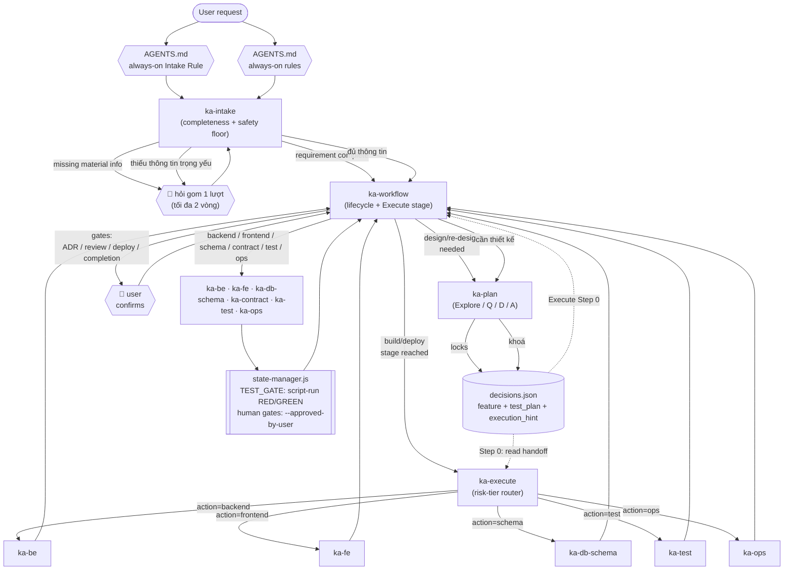

# Ka Skills — `ka-intake` + `ka-plan` + `ka-execute` + `ka-workflow`

# Ka Skills v6 — Pragmatic & Enforced Agent Lifecycle

An agentskills.io-spec-compliant skill set for AI-agent-driven development, covering the full lifecycle: requirement intake → design → execution → orchestration.
Bộ skill tuân thủ chuẩn [agentskills.io](https://agentskills.io) cho phát triển phần mềm có kỷ luật với AI agent (DeepSeek Harness, Claude Code, Codex, Antigravity): **tự chứa độc lập, ép gate bằng script thật thay vì niềm tin, và tỉ lệ nghi thức theo quy mô (Lite vs Full)**.

| Skill | Role | Invocation |

## Danh mục 13 core skills (+ 2 alias tương thích ngược)

| Skill                      | Vai trò                                                                                                                      | Cách gọi                                                                |
| -------------------------- | ----------------------------------------------------------------------------------------------------------------------------- | ------------------------------------------------------------------------- |
| `ka-intake`              | Requirement completeness checker — asks before the AI assumes                                                                | Auto, via the always-on rule in `AGENTS.md` (`user-invocable: false`) |
| `ka-plan`                | Socratic design/architecture facilitator                                                                                      | Auto on ambiguous design questions, or `/ka-plan`                       |
| `ka-execute`             | Risk-tiered execution router to worker skills                                                                                 | Auto after `ka-plan` locks a decision, or `/ka-execute`               |
| `ka-workflow`            | Full lifecycle orchestrator (design → build → review → deploy → archive)                                                  | `/ka-workflow`, or auto when tracking an in-progress feature            |
| `ka-be`                  | Backend implementation developer (Clean Architecture & DDD)                                                                   | Called by `ka-execute` (`user-invocable: false`)                      |
| `ka-fe`                  | Frontend UI implementation developer (React/TanStack)                                                                         | Called by `ka-execute` (`user-invocable: false`)                      |
| `ka-db-schema`           | Database schema designer (Drizzle ORM)                                                                                        | Called by `ka-execute` (`user-invocable: false`)                      |
| `ka-test`                | TDD coach & Test Suite Architect (PGLite, TDD loop, test design catalog)                                                      | Called by developers / execution, or `/ka-test`                         |
| `ka-ops`                 | DevOps & Site Reliability Engineer (Docker/K8s/CI/CD)                                                                         | Called by `ka-execute` (`user-invocable: false`)                      |
| `ka-contract`            | API Contract Designer (OpenAPI / Zod / Orval)                                                                                 | Explicit `/ka-contract` or called during pipeline                       |
| `ka-review`              | Code & Architecture compliance auditor + security depth                                                                       | Explicit `/ka-review` or called during review stage                     |
| `ka-debug`               | Systematic debugger: reproduce → minimize → hypothesis → fix + regression test                                             | Auto on bug/crash/flaky, or `/ka-debug`                                 |
| `git-guardian`           | Git Safety Layer (10 Mandatory Rules)                                                                                         | Called during git commands (`user-invocable: false`)                    |
| `ka-intake`              | Kiểm tra độ đầy đủ yêu cầu nghiệp vụ (có sàn an toàn cho fast-track)                                            | Tự động qua `AGENTS.md` hoặc `/ka-intake`                         |
| `ka-plan`                | Thiết kế & phản biện Socratic (**Explore / Quick / Design / Architecture**), khoá `decisions.json`               | Tự động khi bài toán chưa rõ hoặc `/ka-plan`                    |
| `ka-workflow`            | Điều phối vòng đời + **Execute stage** (validate schema, ép risk tier 1–4, định tuyến worker)                | `/ka-workflow` hoặc khi theo dõi feature đang chạy                  |
| `ka-be`                  | Backend engineer đa ngôn ngữ (TS/NestJS/Hono, Go, Python, Java — hỗ trợ cả **Lite** lẫn **Full 4 tầng**) | Định tuyến từ `ka-workflow`                                         |
| `ka-fe`                  | Frontend engineer (React/TanStack, 3-state UX, a11y WCAG 2.2 AA, RTL + MSW, không hard-stop nội bộ)                        | Định tuyến từ `ka-workflow`                                         |
| `ka-db-schema`           | Kiến trúc schema & migration đa công cụ (Drizzle, SQLAlchemy, Prisma, raw SQL; Risk Tier 3)                              | Định tuyến từ `ka-workflow`                                         |
| `ka-contract`            | Thiết kế hợp đồng API (OpenAPI, Zod/Pydantic, Orval) & kiểm tra breaking change / drift                                 | `/ka-contract` hoặc từ `ka-workflow`                                |
| `ka-test`                | TDD coach & QA architect — ép vòng RED → GREEN thực thi qua `state-manager.js test`                                    | `/ka-test` hoặc tại `TEST_GATE`                                     |
| `ka-debug`               | Debugger 5 pha: tái hiện → thu hẹp → giả thuyết → sửa + regression test (+ postmortem SEV1/2)                        | Tự động khi có bug/crash/flaky hoặc `/ka-debug`                    |
| `ka-review`              | Kiểm toán code, kiến trúc, tenant isolation, security depth & performance có số đo                                     | `/ka-review` hoặc trước `REVIEW_GATE`                              |
| `ka-ops`                 | DevOps/SRE: Docker, K8s least-privilege, release/rollback, observability (Risk Tier 4)                                        | Định tuyến từ `ka-workflow`                                         |
| `ka-handoff`             | Đóng gói trạng thái & ngữ cảnh sang `docs/handoff/` cho phiên làm việc kế tiếp                                  | `/ka-handoff`                                                           |
| `git-guardian`           | Lớp an toàn Git (10 quy tắc bắt buộc, phân loại rủi ro lệnh, chống mất dữ liệu)                                  | Tự động trước mọi lệnh `git`                                     |
| `ka-execute` *(alias)* | Alias mỏng trỏ về `ka-workflow` §4 (giữ tương thích cho lệnh `/ka-execute <action> '<json>'`)                    | Chỉ khi gõ `/ka-execute`                                              |
| `ka-think` *(alias)*   | Alias mỏng trỏ về `ka-plan` Mode E — Explore (tư duy mở, không khoá quyết định)                                  | Chỉ khi gõ `/ka-think`                                                |

---

## 🌟 Key Upgrades & Core Capabilities (Universal Engineering)

## Điểm cốt lõi của kiến trúc v6.0

1. **Polyglot Clean Architecture (TS, Go, Python)**:

   - Unified 4-tier Clean Architecture mapping across TypeScript (NestJS, React, Tauri), Golang (CQRS, Worker Pools), and Python (FastAPI, Hexagonal, SQLite WAL Outbox).
   - Core standards maintained in `standards/UNIVERSAL_CLEAN_STANDARD.md`.
2. **Gate được ép bằng cơ chế trong `state-manager.js`, không dựa vào tự giác của LLM**:

   - **Human gates** (`ADR_GATE`, `REVIEW_GATE`, `BE_FE_GATE_ON_UI`, `DEPLOYMENT_GATE`, `COMPLETION_GATE`, `BLOCKED`) từ chối chuyển trạng thái (exit `4`) nếu thiếu `--approved-by-user "<trích nguyên văn câu user>"` và ghi toàn bộ vào `.agents/memory/approvals.log`.
   - **`TEST_EVIDENCE_GATE`** chỉ chấp nhận kết quả do chính `state-manager.js test --phase red|green --cmd "..."` chạy trực tiếp (exit `2/3` nếu thiếu hoặc sai pha). Cờ `--evidence <json>` do agent tự viết đã bị loại bỏ.
   - **Sàn an toàn Fast-Track**: Fast-track chỉ tự động xác nhận **Tier 1–2**; các thao tác **Tier 3–4** (`schema`, `ops`, auth/tiền/xoá dữ liệu) luôn bắt buộc người dùng xác nhận tường minh.
3. **One-Way Dependency & Registry Pattern (ADR-011)**:

   - Strict DAG module boundaries: Tier 1 (Foundation) ➔ Tier 2 (Domain Core) ➔ Tier 3 (Process Flow).
   - Zero circular dependencies: total ban on `forwardRef()`. Cross-module decoupled via **Registry Pattern** and **Domain Events with Self-Contained Payloads** (`standards/ONE_WAY_REGISTRY_STANDARD.md`).
4. **Đa feature song song (`--feature <slug>`)**:

   - Trạng thái từng tính năng được cô lập tại `.agents/memory/features/<slug>.json`, không ghi đè nhau khi làm nhiều việc cùng lúc.
5. **Fast-Track Autonomous Execution (No Conversational Loops)**:

   - When speed is critical, bypass iterative questioning using pre-packaged spec templates in `skills/ka-intake/templates/`:
     - `fast-track-feature.md`: New features with domain invariants & FSM.
     - `fast-track-hotfix.md`: Root-Cause-First 5-step emergency fixes.
     - `fast-track-worker.md`: Resilient async queues, circuit breakers, offline buffers.
     - `fast-track-refactor.md`: Clean architecture restructuring & cycle breaking.
6. **Hai chế độ vận hành tỉ lệ theo quy mô (`full` vs `lite`)**:

   - **Full profile** (`runtime-templates/workflow.json`): dành cho SaaS multi-tenant, tài chính, phân quyền phức tạp — đầy đủ `DESIGN → ADR → BUILD → TEST → REVIEW → DEPLOY → COMPLETION`, Clean Architecture 4 tầng và 1 file walkthrough hợp nhất mỗi tầng (đã bỏ việc sinh 4 file `.md` rời rạc cho mỗi bước).
   - **Lite profile** (`runtime-templates/workflow.lite.json`): dành cho dự án nhỏ, CLI/script, làm solo hoặc sửa nhanh — chỉ giữ `IN_PROGRESS → TEST_GATE → COMPLETION_GATE` (+ `DEPLOYMENT_GATE` khi có ops), tuân thủ cấu trúc sẵn có của repo, **0 file `.md` phụ trợ**, chỉ tốn **1–2 lượt dừng**.
7. **Interactive E2E Visual Screenshot Testing**:

   - Automated 4-stage visual verification (`artifacts/screenshots/`):
     - `Stage 1`: Initial / Empty State.
     - `Stage 2`: In-flight / Loading & Disabled Button State.
     - `Stage 3`: Success State & Toast notifications.
     - `Stage 4`: Error Banner & Recovery State.
   - Generates visual Markdown reports with embedded screenshot paths (`skills/ka-test/references/visual-screenshot-testing.md`).
8. **Tự chứa 100% khi symlink global**:

   - Mọi template (`ADR.md`, `POSTMORTEM.md`, `fast-track-*.md`) và tài liệu tham chiếu đều nằm gọn bên trong `skills/<name>/`. Linter `scripts/lint-skills.py` chặn tự động mọi đường dẫn trỏ ra ngoài `skills/`.
9. **Smart Deployment & Anti-Bottleneck Node Architecture**:

   - Node separation (API BFF vs Async Worker Nodes).
   - DB Connection Pool formula: $Pool \le (MaxConn \times 0.8) / Instances$ + PgBouncer.
   - Worker concurrency formulas for CPU-bound vs I/O-bound jobs.
   - Zero-Downtime rolling updates with Readiness/Liveness Probes and Graceful Shutdown drains (`skills/ka-ops/references/anti-bottleneck-deployment.md`).
10. **Anti-AI Garbage & Ghost Code Gatekeeper**:

    - Enforces active call-graph reference checks (knip/ts-prune/vulture): bans code with 0 runtime callers.
    - Single Screen Viewport Rule: $\le 40-50$ lines/function, $\le 2$ levels of nesting.
    - Anti-Fraud: Zero hardcoded reconciliation (`if id == ...`), algebraic formulas only (`standards/ANTI_AI_GARBAGE_CODE.md`).
11. **Bilingual Interaction & Autonomous English Policy**:

    - Autonomous engine, tool execution payloads, internal reasoning, and skill definitions execute 100% in English for deterministic reasoning and schema compliance.
    - Interactive mode automatically mirrors the user's input language (Vietnamese/English) for prompts, clarifying questions, Socratic design steps, risk-tier confirmations, and deliverables (`standards/LANGUAGE_AND_INTERACTION_STANDARD.md`).

---

## Why `ka-intake` isn't "just another skill"

## Luồng kết nối

Skills only load when their `description` matches the request — there is no frontmatter field that makes a skill unconditionally active. The one thing that *is* unconditional is `AGENTS.md`. So the "always ask before assuming" behavior is split across two layers:

- **`AGENTS.md`** (see `templates/AGENTS.md.snippet` — append this to your project's real `AGENTS.md`) — the hard, always-loaded rule.
- **`ka-intake`** — the detailed checklist and question logic that rule points to.

Without both pieces, "always active" doesn't actually hold.

---

## How they connect

```
User request
     │
     ▼
AGENTS.md always-on Intake Rule
     │
     ▼
ka-intake — completeness checklist
     │  missing + material? → 🛑 batched questions (max 2 rounds)
     │  complete? ────────────────────────────────┐
     ▼                                             │
ka-workflow (lifecycle orchestrator) ◄─────────────┘
     │
     ├─ design stage ──► ka-plan (D1 → D5) ──locks──► decisions.json (execution_hint)
     │
     └─ build/deploy stage ──► ka-execute
                                   │  Step 0: reads decisions.json if present
                                   │  Step 4b: validates options against schema
                                   │  Step 5: risk-tiered confirmation (1-4)
                                   ▼
                         ka-be / ka-fe / ka-db-schema / ka-test / ka-ops
                                   │
                                   ▼
                         decisions.json updated with consumed_at
```

See `skills/ka-workflow/assets/architecture-overview.mermaid` for the rendered diagram, and `skills/ka-workflow/assets/lifecycle-state-machine.mermaid` for the full state/gate machine.



---

## Usage examples

## Bậc rủi ro (Execute stage — `ka-workflow` §4)

### 1. Vague request → intake asks first

|    Bậc    | Nhóm hành động mặc định                  | Cơ chế xác nhận                                                                         | Fast-track được bỏ qua? |
| :---------: | ----------------------------------------------- | ------------------------------------------------------------------------------------------- | :-------------------------: |
| **1** | `frontend`, `test`                          | Thực thi ngay theo plan đã chốt                                                         |             Có             |
| **2** | `backend`, `contract`                       | Thực thi ngay nếu vừa khoá D3 trong phiên; phiên cũ hỏi `yes/no`                  |             Có             |
| **3** | `schema`; `backend` chạm auth/tiền/tenant | Gõ lại đúng tên action (`schema` / `backend`)                                      |  **Không bao giờ**  |
| **4** | `ops`                                         | Gõ lại `ops` + xác nhận môi trường & kế hoạch rollback + qua `DEPLOYMENT_GATE` |  **Không bao giờ**  |

```
User: hủy đơn hàng #1234
```

→ `ka-intake` checks the checklist, finds "edge_cases" material and missing (đơn đã giao chưa?) → asks in one batched message → user answers → `ka-workflow` proceeds with the complete requirement.

### 2. Full flow: intake clean → design → execute

```
User: nên xử lý auth kiểu gì cho chuẩn, hiện tại đang session-based
```

→ `ka-intake` finds nothing material missing (question is already fully self-contained as a design comparison) → `ka-plan` runs D1–D5 → locks `decisions.json` with `execution_hint` → `ka-execute` Step 0 finds it, confirms, routes to `ka-be`.

### 3. High-risk ops action

```
User: /ka-execute ops '{"env":"production","action":"deploy"}'
```

→ Step 4b rejects: missing `rollback_plan`, required when `env == "production"`. Resubmit → tier-4 confirmation (type "ops" + explicit rollback acknowledgement).

---

## Risk-tier table (`ka-execute` Step 5)

## Cài đặt cho dự án mới

| Tier                                                                                                                                  | Actions                | Confirmation                                                      |
| ------------------------------------------------------------------------------------------------------------------------------------- | ---------------------- | ----------------------------------------------------------------- |
| 1 (low)                                                                                                                               | `frontend`, `test` | Simple yes/no                                                     |
| 2 (medium)                                                                                                                            | `backend`            | Simple yes/no                                                     |
| 3 (high)                                                                                                                              | `schema`             | Type the action name back exactly                                 |
| 4 (highest)                                                                                                                           | `ops`                | Type the action name back + explicit env/rollback acknowledgement |
| Xem chi tiết tại [NEW_PROJECT_SETUP.md](file:///home/ka/Repos/github.com/trongnghiango/agentskills/NEW_PROJECT_SETUP.md). Tóm tắt: |                        |                                                                   |

Full option schemas per action: `skills/ka-execute/references/option-schemas.md`.

---

## File locations

```
templates/AGENTS.md.snippet             ← append to your real AGENTS.md
skills/
├── ka-intake/
│   ├── SKILL.md
│   └── references/
│       ├── completeness-checklist.md
│       └── eval-cases.md
├── ka-plan/
│   ├── SKILL.md
│   └── references/
│       ├── handoff-schema.md
│       ├── trigger-calibration.md
│       └── stax-think.md
├── ka-execute/
│   ├── SKILL.md
│   └── references/
│       ├── option-schemas.md
│       └── eval-cases.md
├── ka-workflow/
│   ├── SKILL.md
│   ├── references/
│   │   └── gates.md
│   └── assets/
│       ├── architecture-overview.mermaid
│       └── lifecycle-state-machine.mermaid
├── ka-be/
│   ├── SKILL.md
│   ├── references/ (golang.md, hono.md, java.md, nestjs.md, nestjs-stax.md)
│   ├── examples/ (user-management.md, approval-workflow.md, inventory-tracking.md)
│   └── templates/ (crud-module.md, event-driven-module.md, etc.)
├── ka-fe/
│   ├── SKILL.md
│   └── templates/ (server-driven-ui.md, query-factory.md)
├── ka-db-schema/
│   └── SKILL.md
├── ka-test/
│   ├── SKILL.md
│   ├── references/ (tdd-loop, test-design-catalog)
│   └── templates/ (factory.ts, test-case.spec.ts)
├── ka-ops/
│   └── SKILL.md
├── ka-contract/
│   └── SKILL.md
├── ka-review/
│   ├── SKILL.md
│   └── references/ (security-audit.md)
├── ka-debug/
│   ├── SKILL.md
│   └── references/ (root-cause-playbook.md)
└── git-guardian/
    ├── SKILL.md
    └── references/ (command-classification.md, rules.md, workflows.md)
```

To set up the skill set inside your target repository, use these commands:

```bash
# Create target skills directory
# 1. Copy hoặc symlink skills vào dự án (nếu chưa cài global tại ~/.agents/skills/)
mkdir -p your-repo/.agents/skills

# Copy the structured skills directly
cp -r skills/* your-repo/.agents/skills/

# Append the always‑on intake snippet to the target project's AGENTS.md
cat templates/AGENTS.md.snippet >> your-repo/AGENTS.md
# 2. Khởi tạo runtime (chọn workflow.json cho Full hoặc workflow.lite.json cho Lite)
mkdir -p your-repo/.agents/{scripts,config,memory}
cp runtime-templates/state-manager.js your-repo/.agents/scripts/state-manager.js
cp runtime-templates/workflow.lite.json your-repo/.agents/config/workflow.json

# 3. Bật Intake Rule vào AGENTS.md của dự án
python3 scripts/enable-intake.py your-repo
```

---

## Kiểm tra chất lượng bộ skill (CI local)

## agentskills.io spec compliance notes

- `name` matches each skill's parent directory exactly.
- `metadata` is a flat string→string map only — no nested arrays/objects (the old `auto-trigger-keywords` field was removed; its content now lives directly in each skill's `description`, per the spec's guidance that descriptions should carry specific keywords).
- Every `SKILL.md` is well under the 500-line guideline (55–94 lines each); detailed schemas, eval sets, and gate descriptions live in `references/`.
- `license`, `compatibility`, and `allowed-tools` are set on all four skills.

---

## Versioning

| Skill            | Version | Notes                                                                                                                          |
| ---------------- | ------- | ------------------------------------------------------------------------------------------------------------------------------ |
| `ka-intake`    | 1.0.0   | New — requirement completeness gate, paired with the AGENTS.md always-on rule                                                 |
| `ka-plan`      | 5.5.0   | Spec-compliant frontmatter, split references, D1 loop-exit, trigger calibration                                                |
| `ka-execute`   | 1.5.0   | Spec-compliant frontmatter, Step 0 handoff, Step 4b schema validation, risk-tier confirmation                                  |
| `ka-workflow`  | 5.0.0   | Delegates to `ka-plan`/`ka-execute` instead of routing directly, references `ka-intake`, retry cap on blocker resolution |
| `ka-be`        | 4.3.0   | Clean Architecture & DDD backend developer (Go, NestJS, Hono, Java references)                                                 |
| `ka-fe`        | 5.2.0   | React/TanStack frontend developer with Server-Driven UI actions and Query factory                                              |
| `ka-db-schema` | 4.0.0   | Relational schema persistence architect using Drizzle ORM                                                                      |
| `ka-test`      | 3.1.0   | TDD loop, TEST_EVIDENCE_GATE contract, test design catalog, typed PGLite blueprint                                             |
| `ka-debug`     | 1.1.0   | Systematic debugger: repro, minimize, hypothesis log, regression test, postmortem (SEV1/2)                                     |
| `ka-think`     | 2.1.0   | Technical thinking facilitator for open problems                                                                               |
| `ka-handoff`   | 1.1.0   | Handoff document writer for cross-session context                                                                              |
| `ka-ops`       | 2.3.0   | SRE & DevOps engineer managing Docker, Kubernetes, and CI/CD pipelines                                                         |
| `ka-contract`  | 5.0.0   | Contract-first API designer using OpenAPI specifications, Zod schemas, and Orval                                               |
| `ka-review`    | 2.4.0   | Static code analyzer, architecture compliance checker, and domain leak auditor                                                 |
| `git-guardian` | 2.1.0   | SOP enforcing git safety rules, branch/commit policies, and disaster recovery                                                  |

Bump the `version` field in a skill's frontmatter whenever its `SKILL.md`, `references/`, or `assets/` change, and record the change in your repo's commit history.

```bash
python3 scripts/lint-skills.py                  # Kiểm tra frontmatter, giới hạn dòng, đường dẫn tự chứa
node scripts/run-evals.mjs                      # Kiểm tra tĩnh bộ eval cases
node scripts/run-evals.mjs --mode heuristic     # Đo baseline phân tách từ khoá offline
bash scripts/test-state-manager.sh              # 49 unit/integration tests cho state-manager (full + lite)
```
