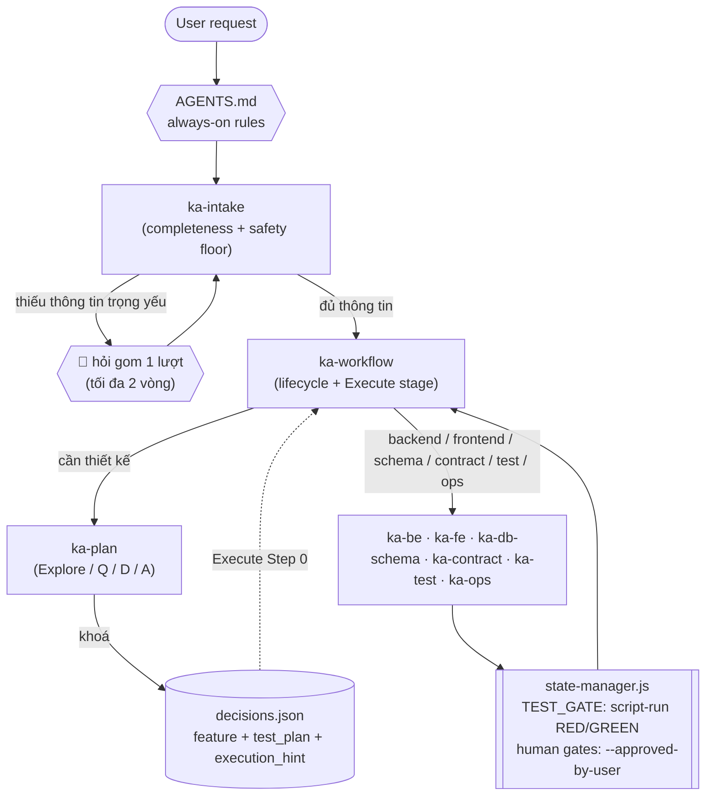

# Ka Skills v6 — Pragmatic & Enforced Agent Lifecycle

Bộ skill tuân thủ chuẩn [agentskills.io](https://agentskills.io) cho phát triển phần mềm có kỷ luật với AI agent (DeepSeek Harness, Claude Code, Codex, Antigravity): **tự chứa độc lập, ép gate bằng script thật thay vì niềm tin, và tỉ lệ nghi thức theo quy mô (Lite vs Full)**.

## Danh mục 13 core skills (+ 2 alias tương thích ngược)

| Skill | Vai trò | Cách gọi |
|---|---|---|
| `ka-intake` | Kiểm tra độ đầy đủ yêu cầu nghiệp vụ (có sàn an toàn cho fast-track) | Tự động qua `AGENTS.md` hoặc `/ka-intake` |
| `ka-plan` | Thiết kế & phản biện Socratic (**Explore / Quick / Design / Architecture**), khoá `decisions.json` | Tự động khi bài toán chưa rõ hoặc `/ka-plan` |
| `ka-workflow` | Điều phối vòng đời + **Execute stage** (validate schema, ép risk tier 1–4, định tuyến worker) | `/ka-workflow` hoặc khi theo dõi feature đang chạy |
| `ka-be` | Backend engineer đa ngôn ngữ (TS/NestJS/Hono, Go, Python, Java — hỗ trợ cả **Lite** lẫn **Full 4 tầng**) | Định tuyến từ `ka-workflow` |
| `ka-fe` | Frontend engineer (React/TanStack, 3-state UX, a11y WCAG 2.2 AA, RTL + MSW, không hard-stop nội bộ) | Định tuyến từ `ka-workflow` |
| `ka-db-schema` | Kiến trúc schema & migration đa công cụ (Drizzle, SQLAlchemy, Prisma, raw SQL; Risk Tier 3) | Định tuyến từ `ka-workflow` |
| `ka-contract` | Thiết kế hợp đồng API (OpenAPI, Zod/Pydantic, Orval) & kiểm tra breaking change / drift | `/ka-contract` hoặc từ `ka-workflow` |
| `ka-test` | TDD coach & QA architect — ép vòng RED → GREEN thực thi qua `state-manager.js test` | `/ka-test` hoặc tại `TEST_GATE` |
| `ka-debug` | Debugger 5 pha: tái hiện → thu hẹp → giả thuyết → sửa + regression test (+ postmortem SEV1/2) | Tự động khi có bug/crash/flaky hoặc `/ka-debug` |
| `ka-review` | Kiểm toán code, kiến trúc, tenant isolation, security depth & performance có số đo | `/ka-review` hoặc trước `REVIEW_GATE` |
| `ka-ops` | DevOps/SRE: Docker, K8s least-privilege, release/rollback, observability (Risk Tier 4) | Định tuyến từ `ka-workflow` |
| `ka-handoff` | Đóng gói trạng thái & ngữ cảnh sang `docs/handoff/` cho phiên làm việc kế tiếp | `/ka-handoff` |
| `git-guardian` | Lớp an toàn Git (10 quy tắc bắt buộc, phân loại rủi ro lệnh, chống mất dữ liệu) | Tự động trước mọi lệnh `git` |
| `ka-execute` *(alias)* | Alias mỏng trỏ về `ka-workflow` §4 (giữ tương thích cho lệnh `/ka-execute <action> '<json>'`) | Chỉ khi gõ `/ka-execute` |
| `ka-think` *(alias)* | Alias mỏng trỏ về `ka-plan` Mode E — Explore (tư duy mở, không khoá quyết định) | Chỉ khi gõ `/ka-think` |

---

## Điểm cốt lõi của kiến trúc v6.0

1. **Gate được ép bằng cơ chế trong `state-manager.js`, không dựa vào tự giác của LLM**:
   - **Human gates** (`ADR_GATE`, `REVIEW_GATE`, `BE_FE_GATE_ON_UI`, `DEPLOYMENT_GATE`, `COMPLETION_GATE`, `BLOCKED`) từ chối chuyển trạng thái (exit `4`) nếu thiếu `--approved-by-user "<trích nguyên văn câu user>"` và ghi toàn bộ vào `.agents/memory/approvals.log`.
   - **`TEST_EVIDENCE_GATE`** chỉ chấp nhận kết quả do chính `state-manager.js test --phase red|green --cmd "..."` chạy trực tiếp (exit `2/3` nếu thiếu hoặc sai pha). Cờ `--evidence <json>` do agent tự viết đã bị loại bỏ.
   - **Sàn an toàn Fast-Track**: Fast-track chỉ tự động xác nhận **Tier 1–2**; các thao tác **Tier 3–4** (`schema`, `ops`, auth/tiền/xoá dữ liệu) luôn bắt buộc người dùng xác nhận tường minh.

2. **Đa feature song song (`--feature <slug>`)**:
   - Trạng thái từng tính năng được cô lập tại `.agents/memory/features/<slug>.json`, không ghi đè nhau khi làm nhiều việc cùng lúc.

3. **Hai chế độ vận hành tỉ lệ theo quy mô (`full` vs `lite`)**:
   - **Full profile** (`runtime-templates/workflow.json`): dành cho SaaS multi-tenant, tài chính, phân quyền phức tạp — đầy đủ `DESIGN → ADR → BUILD → TEST → REVIEW → DEPLOY → COMPLETION`, Clean Architecture 4 tầng và 1 file walkthrough hợp nhất mỗi tầng (đã bỏ việc sinh 4 file `.md` rời rạc cho mỗi bước).
   - **Lite profile** (`runtime-templates/workflow.lite.json`): dành cho dự án nhỏ, CLI/script, làm solo hoặc sửa nhanh — chỉ giữ `IN_PROGRESS → TEST_GATE → COMPLETION_GATE` (+ `DEPLOYMENT_GATE` khi có ops), tuân thủ cấu trúc sẵn có của repo, **0 file `.md` phụ trợ**, chỉ tốn **1–2 lượt dừng**.

4. **Tự chứa 100% khi symlink global**:
   - Mọi template (`ADR.md`, `POSTMORTEM.md`, `fast-track-*.md`) và tài liệu tham chiếu đều nằm gọn bên trong `skills/<name>/`. Linter `scripts/lint-skills.py` chặn tự động mọi đường dẫn trỏ ra ngoài `skills/`.

---

## Luồng kết nối



---

## Bậc rủi ro (Execute stage — `ka-workflow` §4)

| Bậc | Nhóm hành động mặc định | Cơ chế xác nhận | Fast-track được bỏ qua? |
|:-:|---|---|:-:|
| **1** | `frontend`, `test` | Thực thi ngay theo plan đã chốt | Có |
| **2** | `backend`, `contract` | Thực thi ngay nếu vừa khoá D3 trong phiên; phiên cũ hỏi `yes/no` | Có |
| **3** | `schema`; `backend` chạm auth/tiền/tenant | Gõ lại đúng tên action (`schema` / `backend`) | **Không bao giờ** |
| **4** | `ops` | Gõ lại `ops` + xác nhận môi trường & kế hoạch rollback + qua `DEPLOYMENT_GATE` | **Không bao giờ** |

---

## Cài đặt cho dự án mới

Xem chi tiết tại [NEW_PROJECT_SETUP.md](file:///home/ka/Repos/github.com/trongnghiango/agentskills/NEW_PROJECT_SETUP.md). Tóm tắt:

```bash
# 1. Copy hoặc symlink skills vào dự án (nếu chưa cài global tại ~/.agents/skills/)
mkdir -p your-repo/.agents/skills
cp -r skills/* your-repo/.agents/skills/

# 2. Khởi tạo runtime (chọn workflow.json cho Full hoặc workflow.lite.json cho Lite)
mkdir -p your-repo/.agents/{scripts,config,memory}
cp runtime-templates/state-manager.js your-repo/.agents/scripts/state-manager.js
cp runtime-templates/workflow.lite.json your-repo/.agents/config/workflow.json

# 3. Bật Intake Rule vào AGENTS.md của dự án
python3 scripts/enable-intake.py your-repo
```

## Kiểm tra chất lượng bộ skill (CI local)

```bash
python3 scripts/lint-skills.py                  # Kiểm tra frontmatter, giới hạn dòng, đường dẫn tự chứa
node scripts/run-evals.mjs                      # Kiểm tra tĩnh bộ eval cases
node scripts/run-evals.mjs --mode heuristic     # Đo baseline phân tách từ khoá offline
bash scripts/test-state-manager.sh              # 49 unit/integration tests cho state-manager (full + lite)
```
